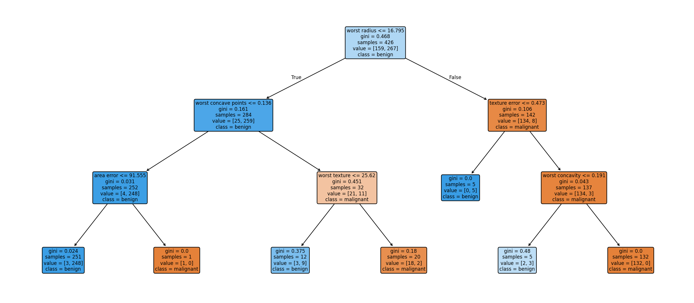
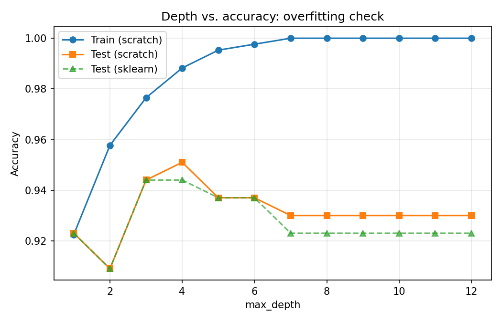
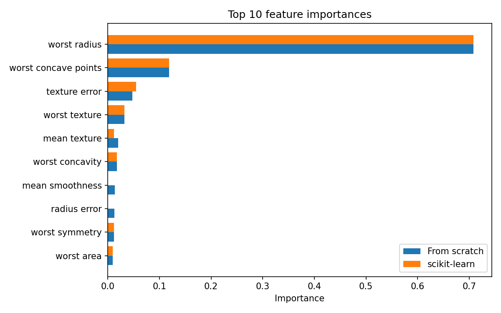
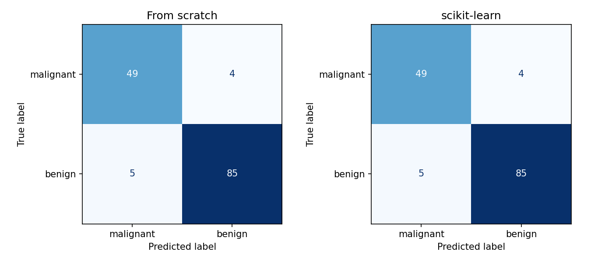

# 🌳 Decision Trees from Scratch vs. scikit-learn

A decision tree classifier built from scratch in pure Python/NumPy (Gini impurity, entropy, information gain, recursive splitting), then benchmarked against scikit-learn on the **Breast Cancer Wisconsin** dataset.



## Problem
Classify tumours as **malignant** or **benign** from 30 numeric cell-nucleus features (569 samples: 212 malignant, 357 benign). The goal is less the dataset than understanding *how a tree chooses its splits*.

## Approach
1. **From-scratch implementation** (`src/decision_tree.py`): Gini and entropy criteria, exhaustive best-split search over every feature and midpoint threshold, recursive building, `max_depth` / `min_samples_split` / `min_samples_leaf`, `predict()`, feature importances and a text tree export.
2. **Comparison** against `sklearn.tree.DecisionTreeClassifier` with identical settings (75/25 stratified split, `random_state=42`, `max_depth=5`).
3. **Overfitting study**: train vs. test accuracy as depth grows.
4. **Extension**: Random Forest (200 trees).

## Results (test set, 143 samples)

| Model | Accuracy | Precision | Recall | F1 |
|---|---|---|---|---|
| From scratch (Gini, depth 5) | 93.7% | 95.5% | 94.4% | 95.0% |
| scikit-learn (Gini, depth 5) | 93.7% | 95.5% | 94.4% | 95.0% |
| Random Forest (200 trees) | 95.8% | 95.7% | 97.8% | 96.7% |

- The from-scratch tree **matched scikit-learn on 100% of test predictions**.
- Speed: ~0.62 s to fit vs. ~0.008 s for sklearn (pure Python loops vs. optimized Cython).
- Entropy vs. Gini (from scratch, depth 5): 95.1% vs. 93.7%. On 143 test samples that is a 2-sample difference, so treat it as noise rather than a finding.

### Depth vs. overfitting


Training accuracy climbs to 100% by depth 7, while test accuracy peaks at **95.1% at depth 4** and then declines to 93.0%. Deeper trees memorize the training set.

### Feature importance


`worst radius` dominates the from-scratch tree (about 71% of total impurity reduction), followed by `worst concave points` (about 12%).

### Confusion matrices


## Run it
```bash
pip install -r requirements.txt
python run_experiments.py          # regenerates all plots + results/results.json
jupyter notebook notebooks/analysis.ipynb
```

## Structure
```
├── src/decision_tree.py     # from-scratch implementation
├── src/utils.py             # metrics helper
├── run_experiments.py       # reproducible experiment script
├── notebooks/analysis.ipynb # walkthrough
└── results/                 # plots, results.json, scratch_tree.txt
```

## Key learnings
- A tree is greedy: each split maximizes immediate information gain, which is why unconstrained trees overfit.
- Depth is the strongest regularizer here; the best depth (4) was far below the point where training accuracy hit 100%.
- Single decision trees are interpretable but high-variance; the Random Forest gained about 2 points of accuracy.

## Limitations and future work
- Results come from a single train/test split on a small test set; use k-fold cross-validation for tighter estimates.
- Add cost-complexity pruning, categorical feature support, and a regression tree.
- Repeat on Titanic to test handling of missing values.
